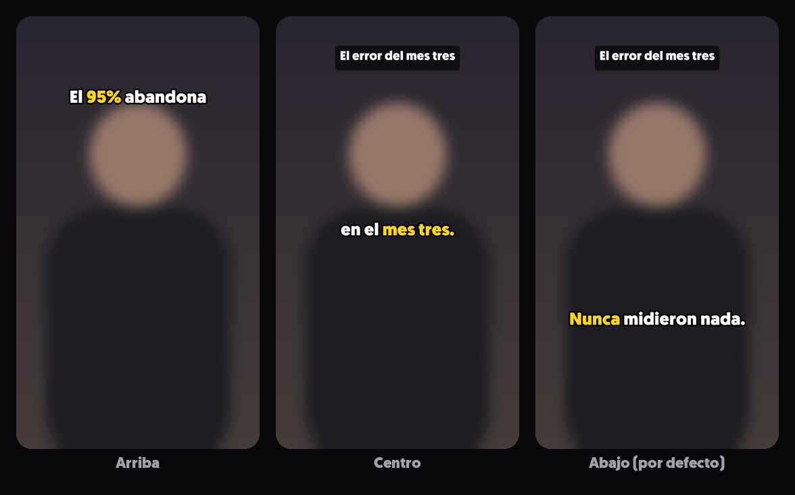
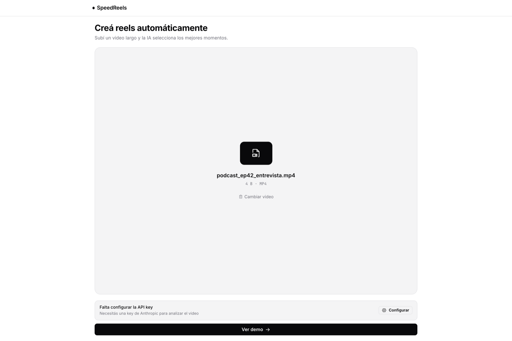
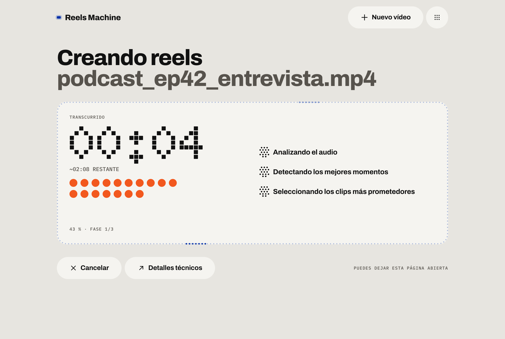
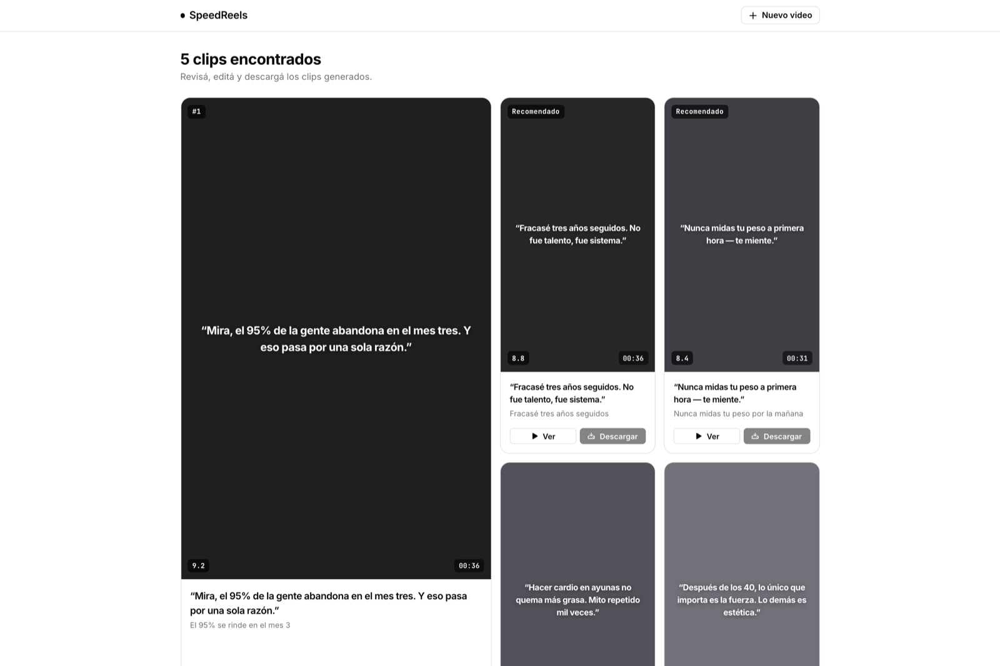
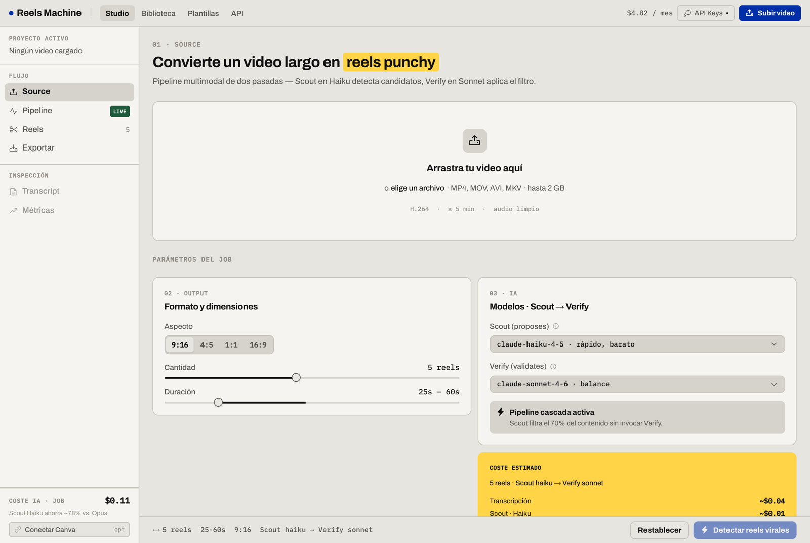

<p align="center">
  
</p>

<p align="center">
  <b>Sube un vídeo largo y SpeedReels te devuelve los mejores momentos ya cortados en 9:16, con título y subtítulos.</b><br>
  Analiza el audio y el texto en tu máquina y llama a Claude una sola vez para elegir con criterio de editor.
</p>

<p align="center">
  
  
  
  
  
  
</p>

---

## Qué hace

1. **Subes** un podcast, una charla o una entrevista (MP4, MOV, AVI o MKV, hasta 2 GB).
2. **SpeedReels escucha**: detecta silencios, energía de la voz, tono, ritmo y frases que no se repiten, y transcribe con Deepgram o con Whisper en local.
3. **Puntúa cada frase** con un *viral score* multimodal y se queda con las 25 mejores ventanas.
4. **Claude actúa de director**: con tu *brief* elige los N clips que detienen el scroll, con hook, payoff, que se entiendan solos y que acaben en frase completa.
5. **FFmpeg corta** cada reel en 9:16 (1080×1920), con título y **subtítulos de marca** quemados, listo para descargar o subir a Canva.

<p align="center">
  
</p>

## Subtítulos de marca

Los subtítulos van en Geomanist Black, en blanco con contorno negro duro y sin sombra, y el texto aparece tal cual se dice. El director IA elige **de 1 a 3 palabras clave por clip** y se resaltan en amarillo `#FFD60A`. Si la IA propone una frase que no está en el clip, se ignora y el subtítulo sale igual, todo en blanco.

<p align="center"></p>

- **Posición** (arriba, centro o abajo), **margen lateral** (0–160 px) y **palabras por bloque** (1–6) se ajustan en <kbd>⌘</kbd> <kbd>,</kbd> → *Subtítulos*, o en la tarjeta *Subtítulos* de la vista técnica.
- Además del MP4, cada corte deja un **`.ass` editable** con el mismo estilo, para retocarlo en Premiere, CapCut o Aegisub.
- Título y subtítulos se pintan con Pillow y se superponen con el filtro `overlay`, así que **sirve cualquier FFmpeg**, también el de Homebrew, que no trae libass ni freetype.
- La fuente es comercial y **no está en el repositorio**: copia `Geomanist-Black.otf` en `Cinemania_files/assets/fonts/` (ver [su README](Cinemania_files/assets/fonts/README.md)). Sin ella se usa una sans gruesa del sistema con el mismo estilo.

## Capturas

| Subir | Procesando | Reels listos |
|:--:|:--:|:--:|
|  |  |  |

La **vista técnica** (`?debug=1`) muestra todos los parámetros: formato, duración, modelos, coste estimado, transcript y métricas por clip.

<p align="center"></p>

## Puesta en marcha

Necesitas **macOS o Linux**, **Python 3.11+**, **Node 20.19+** y **FFmpeg**. El script de instalación pone FFmpeg con Homebrew si falta.

```bash
git clone https://github.com/olmedcr-cmyk/speedreels.git && cd speedreels
./scripts/setup.sh     # venv Python + dependencias + pnpm install + .env
./scripts/dev.sh       # backend :8000 + frontend :5173
```

Abre **http://localhost:5173**.

> **Modo demo:** sin clave de Anthropic (ni en `.env` ni en la app) la interfaz recorre el pipeline simulado y muestra reels de ejemplo. Sirve para enseñar el producto sin gastar nada.

### Claves

Copia `.env.example` a `.env`. El script de instalación ya lo hace.

| Variable | Para qué | ¿Obligatoria? |
|---|---|---|
| `ANTHROPIC_API_KEY` | El director IA que elige los clips | Sí, para el modo real |
| `DEEPGRAM_API_KEY` | Transcripción rápida con sentimiento | No: si falta, se usa Whisper en local |

También puedes ponerlas en la app con <kbd>⌘</kbd> <kbd>,</kbd>. Se guardan sólo en tu navegador y tienen prioridad sobre el `.env`.

## Arquitectura

```
SpeedReels/          Frontend — React 19 · Vite · Tailwind v4 · shadcn/ui · Phosphor
  src/App.tsx          flujo simple: subir → procesando (SSE) → reels
  src/DebugApp.tsx     vista técnica completa (?debug=1)
  src/lib/api.ts       cliente REST + EventSource
backend/server.py    API FastAPI: upload · analyze (SSE) · cut-one · clips · video (Range) · health
Cinemania_files/     Motor: reel_cutter.py (señales, viral score, director IA, FFmpeg)
  subtitles.py         subtítulos de marca: highlight, overlay PNG y .ass
  app.py               interfaz Streamlit alternativa (la herramienta original)
  tests/               tests de detección (pytest)
docs/PIPELINE.md     documentación técnica paso a paso
scripts/             setup.sh · dev.sh
```

| Endpoint | Qué hace |
|---|---|
| `POST /api/upload` | Recibe el vídeo y devuelve `jobId` y duración |
| `POST /api/analyze` · `GET /api/analyze/stream/{id}` | Lanza el pipeline y emite el progreso por SSE (`EX-01` … `AI-02`, `DONE`) |
| `POST /api/cut-one` | Corta un reel bajo demanda: 9:16 u original, título, subtítulos (`subPosition`, `subPadding`, `wordsPerSub`) |
| `GET /api/clips/{id}/{file}` | Descarga el clip (`.mp4`) o sus subtítulos (`.ass`) |
| `GET /api/video/{id}` | *Streaming* del original con soporte de `Range` |
| `GET /api/health` | Estado del servidor y qué claves tiene en `.env` |

### El viral score

| Señal | Peso | Qué capta |
|---|---:|---|
| Energía RMS | 30 % | Momentos de intensidad vocal |
| Novelty TF-IDF | 20 % | Frases únicas frente a relleno repetido |
| Varianza de pitch | 15 % | Emoción en la voz |
| Sentimiento | 15 % | Intensidad, positiva o negativa |
| Densidad de onsets | 10 % | Ritmo y urgencia al hablar |
| Brillo espectral | 10 % | Claridad y entusiasmo |

Si alguna señal no está disponible, el score se recalcula sólo con las demás. El detalle completo está en [docs/PIPELINE.md](docs/PIPELINE.md).

## Otras formas de usarlo

```bash
# CLI: 5 reels verticales de 45–60 s
backend/.venv/bin/python Cinemania_files/reel_cutter.py mi_video.mp4 --num-reels 5 --min-duration 45 --max-duration 60

# Interfaz Streamlit original
backend/.venv/bin/pip install "streamlit>=1.28"
cd Cinemania_files && ../backend/.venv/bin/streamlit run app.py
```

## Desarrollo

```bash
(cd SpeedReels && pnpm build)                                          # type-check + build de producción
backend/.venv/bin/pip install -r backend/requirements-dev.txt
backend/.venv/bin/python -m pytest -q Cinemania_files/tests backend/tests  # motor + API (necesita ffmpeg)
```

El backend escucha en `127.0.0.1` por defecto. Para abrirlo a tu red local usa `HOST=0.0.0.0`.

## Hoja de ruta

- [x] **Subtítulos de marca:** Geomanist, contorno duro y palabras clave en amarillo elegidas por la IA ([spec](SpeedReels/docs/superpowers/specs/2026-07-13-subtitle-style-design.md)).
- [ ] B-rolls automáticos (spec aparte).
- [ ] La vista técnica todavía nombra las fases «Scout» y «Verify» del pipeline anterior; el motor ya usa el modo Director.
- [ ] Persistir los jobs: ahora viven en memoria y en `$TMPDIR/cinemania_jobs`.
